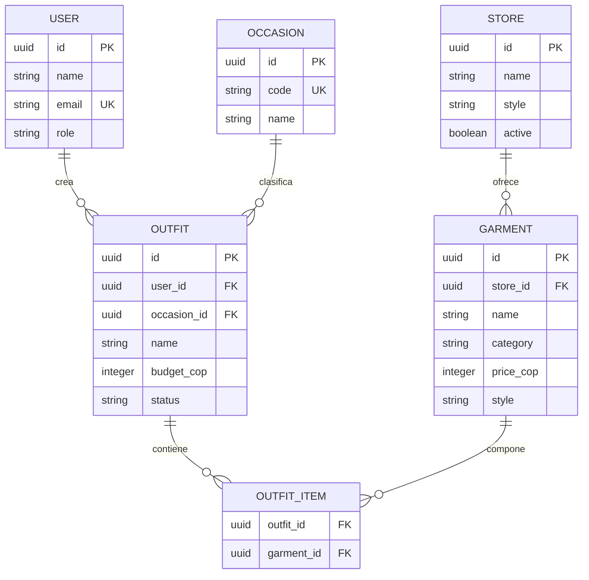
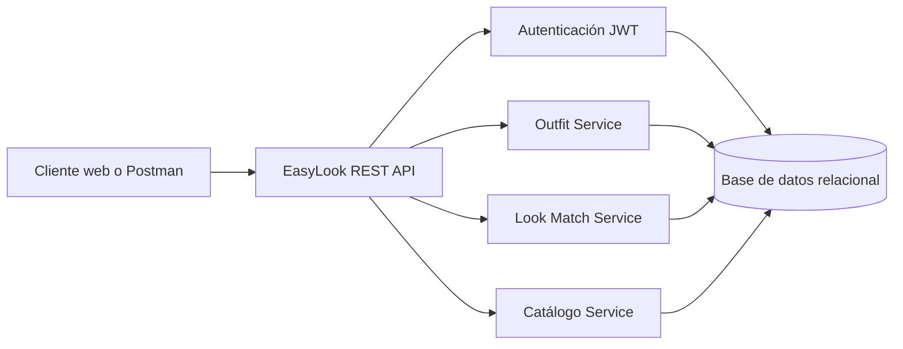

# EasyLook API

**Versión:** 1.0 — propuesta inicial  
**Tipo:** API REST  
**Propósito:** proyecto académico de Computación Orientada a Servicios

## Puesta en marcha

La API está implementada en este repositorio. Para correrla en local hacen falta Node.js 20 o superior y PostgreSQL 16:

```bash
npm install
cp .env.example .env      # cambia JWT_SECRET
docker compose up -d db   # o usa un PostgreSQL propio y ajusta DATABASE_URL
npm run db:reset          # migraciones y catálogo ficticio
npm run dev
```

La documentación interactiva queda en `http://localhost:3000/docs`. El manual de instalación, el recorrido de demostración con las cuentas de prueba, la explicación de Look Match y las decisiones de implementación están en [docs/MANUAL.md](docs/MANUAL.md). La especificación OpenAPI exportada está en [docs/openapi.json](docs/openapi.json).

```bash
npm test                  # pruebas unitarias y de integración
```

## 1. Resumen

**EasyLook** es una API REST para descubrir prendas de tiendas simuladas y crear outfits para una ocasión sin realizar pagos ni gestionar inventario real. Una persona explora un catálogo, reúne prendas de distintas tiendas en un outfit y lo guarda en su look book personal.

La API incorpora presupuesto, validación de combinaciones y un recomendador llamado **Look Match**. Con una ocasión, un presupuesto y preferencias opcionales, Look Match devuelve hasta tres outfits completos: una alternativa equilibrada, una económica y una destacada. Cada propuesta incluye una explicación breve de por qué funciona y cuánto dinero queda disponible. Este resultado es reproducible mediante reglas de negocio; no requiere entrenar un modelo de inteligencia artificial.

> EasyLook recomienda looks con un catálogo ficticio. No procesa compras, pagos, envíos, inventario real ni datos financieros.

## 2. Problema y propuesta de valor

Encontrar un outfit para una cita, oficina, brunch o fiesta exige combinar estilo, presupuesto y prendas de distintos lugares. Un CRUD básico permitiría guardar outfits, pero no ayudaría a decidir.

EasyLook resuelve esa decisión con tres capacidades alcanzables:

1. **Compra simulada entre tiendas:** el outfit puede contener prendas de varias tiendas ficticias.
2. **Presupuesto visible:** el total y el saldo se recalculan cada vez que se agrega o quita una prenda.
3. **Look Match explicable:** propone alternativas completas y muestra las reglas que las hicieron adecuadas para la ocasión y el presupuesto.

## 3. Objetivos

### Objetivo general

Desarrollar una API REST que permita administrar un catálogo de moda simulado, construir outfits por ocasión y generar recomendaciones explicables dentro de un presupuesto.

### Objetivos específicos

- Gestionar usuarios, tiendas, prendas, ocasiones y outfits.
- Permitir filtrar prendas por tienda, categoría, estilo, ocasión, talla, color y precio.
- Calcular el costo total y el presupuesto restante de un outfit.
- Evitar prendas duplicadas y validar que un outfit cumpla una estructura mínima.
- Generar hasta tres sugerencias de outfit mediante reglas configurables.
- Guardar y consultar el historial personal de looks.

## 4. Alcance del MVP

### Incluido

- Autenticación con JWT.
- Catálogo ficticio de tiendas y prendas.
- Filtros, paginación y búsqueda de prendas.
- Creación, edición, consulta y eliminación de outfits.
- Asociación de outfits a una ocasión y un presupuesto.
- Cálculo de total, saldo y estado del presupuesto.
- Recomendador Look Match basado en reglas.
- Look book personal e historial de outfits.

### No incluido

- Pasarela de pagos, carrito de compra comercial o pedidos.
- Inventario y precios en tiempo real.
- Imágenes generadas por IA, probador virtual o reconocimiento de imagen.
- Red social, comentarios, mensajes o seguimiento entre usuarios.
- Recomendaciones basadas en datos personales sensibles.

## 5. Roles

| Rol | Permisos |
| --- | --- |
| Visitante | Consultar tiendas, prendas, ocasiones y sugerencias públicas de ejemplo. |
| Usuario autenticado | Crear y administrar únicamente sus outfits y preferencias. |
| Administrador | Crear, editar o desactivar tiendas, prendas y ocasiones del catálogo. |

## 6. Requisitos funcionales

| ID | Requisito |
| --- | --- |
| RF-01 | El sistema debe permitir registrar usuarios e iniciar sesión. |
| RF-02 | El sistema debe listar tiendas y sus estilos. |
| RF-03 | El sistema debe listar y filtrar prendas por atributos y precio. |
| RF-04 | El usuario debe poder crear un outfit para una ocasión con presupuesto opcional. |
| RF-05 | El usuario debe poder agregar o retirar prendas de su outfit. |
| RF-06 | El sistema debe calcular total, presupuesto restante y estado del presupuesto. |
| RF-07 | El sistema debe impedir duplicar la misma prenda en un outfit. |
| RF-08 | El sistema debe generar hasta tres sugerencias Look Match. |
| RF-09 | El usuario debe poder guardar, editar, eliminar y consultar su look book. |
| RF-10 | El administrador debe poder mantener el catálogo ficticio. |

## 7. Reglas de negocio

1. Cada prenda pertenece a una sola tienda, pero un outfit puede mezclar prendas de múltiples tiendas.
2. Una prenda solo puede aparecer una vez dentro del mismo outfit.
3. Un outfit se considera **completo** cuando contiene al menos una prenda superior (`top`), una inferior (`bottom`) y calzado (`shoes`). Para vestidos, `dress` reemplaza la combinación `top + bottom`.
4. El total es la suma de los precios de sus prendas; el saldo es `presupuesto - total`.
5. Si no hay presupuesto, el estado es `not_set`; si el total lo supera, es `over_budget`; de lo contrario, `within_budget`.
6. Look Match prioriza prendas compatibles con la ocasión, disponibles en el catálogo simulado y dentro del presupuesto. Si no existe un look completo bajo el valor indicado, lo informa y puede devolver la opción más cercana solo si se solicita `allowOverBudget=true`.
7. Las ocasiones admitidas inicialmente son: `date`, `office`, `brunch`, `party` y `casual`.
8. Para el MVP en Colombia, los precios se almacenan como enteros en pesos colombianos (`priceCop`), sin decimales.

## 8. Modelo de datos



### Categorías de prenda

`top`, `bottom`, `dress`, `shoes`, `outerwear` y `accessory`.

## 9. Arquitectura propuesta



Para el MVP se recomienda una arquitectura monolítica modular: una sola API y una base de datos relacional. Es más fácil de desarrollar, probar y desplegar que microservicios, sin perder una separación clara entre autenticación, catálogo, outfits y recomendaciones.

## 10. Convenciones de la API

| Elemento | Decisión |
| --- | --- |
| URL base | `/api/v1` |
| Formato | JSON UTF-8 |
| Autenticación | `Authorization: Bearer <JWT>` |
| Identificadores | UUID |
| Fechas | ISO 8601 en UTC |
| Moneda | `COP` inicialmente; precio en `priceCop` |
| Paginación | `page` y `limit`; límite máximo de 100 |
| Errores | Objeto JSON uniforme con código, mensaje y detalles opcionales |

Ejemplo de respuesta de error:

```json
{
  "error": {
    "code": "BUDGET_EXCEEDED",
    "message": "El outfit supera el presupuesto definido.",
    "details": { "budgetCop": 300000, "totalCop": 326000 }
  }
}
```

## 11. Recursos y endpoints

### 11.1 Autenticación

| Método | Ruta | Acceso | Descripción |
| --- | --- | --- | --- |
| POST | `/auth/register` | Público | Crea una cuenta. |
| POST | `/auth/login` | Público | Devuelve un JWT. |
| GET | `/auth/me` | Autenticado | Devuelve el usuario actual. |

### 11.2 Tiendas y ocasiones

| Método | Ruta | Acceso | Descripción |
| --- | --- | --- | --- |
| GET | `/stores` | Público | Lista tiendas; admite `style`, `page`, `limit`. |
| GET | `/stores/{storeId}` | Público | Consulta una tienda. |
| GET | `/occasions` | Público | Lista ocasiones disponibles. |
| POST | `/stores` | Administrador | Crea una tienda. |
| PATCH | `/stores/{storeId}` | Administrador | Edita una tienda. |

### 11.3 Prendas

| Método | Ruta | Acceso | Descripción |
| --- | --- | --- | --- |
| GET | `/garments` | Público | Lista prendas con filtros. |
| GET | `/garments/{garmentId}` | Público | Consulta una prenda. |
| POST | `/garments` | Administrador | Crea una prenda. |
| PATCH | `/garments/{garmentId}` | Administrador | Edita una prenda. |
| DELETE | `/garments/{garmentId}` | Administrador | Desactiva una prenda. |

Filtros admitidos: `storeId`, `category`, `style`, `occasion`, `color`, `size`, `minPriceCop`, `maxPriceCop`, `sort=price_asc|price_desc`.

### 11.4 Outfits y look book

| Método | Ruta | Acceso | Descripción |
| --- | --- | --- | --- |
| POST | `/outfits` | Autenticado | Crea un outfit vacío. |
| GET | `/outfits` | Autenticado | Lista únicamente los outfits del usuario. |
| GET | `/outfits/{outfitId}` | Propietario | Consulta el detalle y su total. |
| PATCH | `/outfits/{outfitId}` | Propietario | Cambia nombre, ocasión o presupuesto. |
| DELETE | `/outfits/{outfitId}` | Propietario | Elimina el outfit. |
| POST | `/outfits/{outfitId}/items` | Propietario | Agrega una prenda. |
| DELETE | `/outfits/{outfitId}/items/{garmentId}` | Propietario | Retira una prenda. |
| POST | `/outfits/{outfitId}/finalize` | Propietario | Valida y marca el outfit como guardado. |

### 11.5 Look Match (recomendador)

| Método | Ruta | Acceso | Descripción |
| --- | --- | --- | --- |
| POST | `/recommendations/look-match` | Público o autenticado | Genera hasta tres propuestas explicables. |
| POST | `/outfits/{outfitId}/apply-recommendation` | Propietario | Copia una propuesta en un outfit existente. |

## 12. Ejemplos de uso

### Crear un outfit

`POST /api/v1/outfits`

```json
{
  "name": "Brunch de domingo",
  "occasionCode": "brunch",
  "budgetCop": 350000,
  "currency": "COP"
}
```

Respuesta `201 Created`:

```json
{
  "id": "7788f9aa-2919-4b1a-a9b4-4318f33dd001",
  "name": "Brunch de domingo",
  "occasion": { "code": "brunch", "name": "Brunch" },
  "budgetCop": 350000,
  "currency": "COP",
  "totalCop": 0,
  "remainingCop": 350000,
  "budgetStatus": "within_budget",
  "status": "draft",
  "items": []
}
```

### Agregar una prenda

`POST /api/v1/outfits/7788f9aa-2919-4b1a-a9b4-4318f33dd001/items`

```json
{ "garmentId": "28a58b2a-c847-44d4-a2ca-ec1dc35b1001" }
```

Respuesta `200 OK`:

```json
{
  "outfitId": "7788f9aa-2919-4b1a-a9b4-4318f33dd001",
  "totalCop": 149900,
  "remainingCop": 200100,
  "budgetStatus": "within_budget",
  "items": [
    {
      "id": "28a58b2a-c847-44d4-a2ca-ec1dc35b1001",
      "name": "Blazer crema",
      "category": "outerwear",
      "priceCop": 149900,
      "store": { "name": "Atelier Norte" }
    }
  ]
}
```

### Generar propuestas Look Match

`POST /api/v1/recommendations/look-match`

```json
{
  "occasionCode": "date",
  "budgetCop": 400000,
  "preferredStyles": ["elegant", "minimal"],
  "excludedCategories": ["outerwear"],
  "allowOverBudget": false
}
```

Respuesta `200 OK`:

```json
{
  "occasion": "date",
  "budgetCop": 400000,
  "recommendations": [
    {
      "label": "balanced",
      "score": 92,
      "totalCop": 372000,
      "remainingCop": 28000,
      "items": ["Top satinado", "Pantalón sastre", "Tacones negros"],
      "storeCount": 2,
      "explanation": [
        "Incluye las piezas mínimas para un look completo.",
        "Combina con el estilo elegante y la ocasión seleccionada.",
        "Se mantiene dentro del presupuesto."
      ]
    },
    {
      "label": "budget",
      "score": 84,
      "totalCop": 298000,
      "remainingCop": 102000,
      "items": ["Blusa clásica", "Falda midi", "Baletas"],
      "storeCount": 3,
      "explanation": ["Es la alternativa completa con menor costo."]
    }
  ]
}
```

## 13. Lógica de Look Match

Look Match es el componente diferenciador y se implementa con reglas transparentes:

1. Obtiene prendas activas compatibles con la ocasión y los filtros recibidos.
2. Forma combinaciones válidas: `top + bottom + shoes` o `dress + shoes`.
3. Elimina combinaciones que superen el presupuesto, salvo que se habilite una excepción.
4. Puntúa cada combinación: compatibilidad de ocasión (40%), afinidad de estilo (30%), ajuste al presupuesto (20%) y variedad de tiendas (10%).
5. Devuelve un máximo de tres resultados distintos: `balanced`, `budget` y `statement`.
6. Explica en lenguaje sencillo las razones de cada resultado y reporta cuándo no encontró una combinación válida.

Este enfoque tiene valor demostrable, se puede probar con datos semilla y es mucho más viable que un sistema de IA generativa o un motor de visión por computadora.

## 14. Seguridad y calidad

- Contraseñas con hash seguro; nunca en texto plano.
- JWT con expiración; rutas protegidas por autenticación y rol.
- Validación de todos los campos de entrada y consultas parametrizadas.
- Autorización por propiedad: un usuario solo administra sus propios outfits.
- Límites de peticiones en autenticación y recomendador para evitar abusos.
- Registro de errores sin exponer contraseñas ni tokens.
- Pruebas unitarias para reglas de presupuesto y Look Match; pruebas de integración para endpoints.

## 15. Códigos HTTP y errores

| Código | Uso |
| --- | --- |
| 200 | Consulta o actualización exitosa. |
| 201 | Recurso creado. |
| 204 | Recurso eliminado. |
| 400 | Solicitud inválida o regla de negocio incumplida. |
| 401 | Falta autenticación o el token no es válido. |
| 403 | El rol o propiedad no permite la acción. |
| 404 | Recurso no encontrado. |
| 409 | Prenda duplicada en el outfit. |
| 422 | Datos válidos en formato, pero imposibles de procesar; por ejemplo, no hay combinación para los filtros. |
| 500 | Error no controlado del servidor. |

Errores de negocio sugeridos: `GARMENT_ALREADY_ADDED`, `BUDGET_EXCEEDED`, `OUTFIT_INCOMPLETE`, `NO_MATCH_FOUND`, `STORE_INACTIVE` y `FORBIDDEN_RESOURCE`.

## 16. Tecnología sugerida

| Capa | Alternativa recomendada |
| --- | --- |
| API | Node.js + Express + TypeScript, o Java + Spring Boot |
| Base de datos | PostgreSQL |
| ORM | Prisma (Node.js) o JPA/Hibernate (Spring Boot) |
| Documentación interactiva | OpenAPI / Swagger |
| Pruebas | Jest + Supertest, o JUnit + MockMvc |
| Control de versiones | Git y GitHub |

La elección final debe seguir el lenguaje trabajado en la asignatura. Para un equipo pequeño, Node.js con Express y PostgreSQL es una opción directa y suficiente.

## 17. Plan de desarrollo sugerido

| Sprint | Resultado |
| --- | --- |
| 1 | Repositorio, arquitectura, base de datos, autenticación y roles. |
| 2 | Tiendas, ocasiones y prendas con filtros y datos semilla. |
| 3 | Outfits, items, cálculo de presupuesto y look book. |
| 4 | Look Match, pruebas, Swagger y video de demostración. |

## 18. Entregables

1. Este documento de especificación.
2. Diagrama entidad-relación y diagrama de arquitectura.
3. Repositorio con código fuente y datos semilla.
4. Colección de Postman o especificación OpenAPI/Swagger.
5. Pruebas automatizadas de las reglas principales.
6. Manual breve de instalación y demostración de los endpoints.

## 19. Criterios de éxito

El MVP estará terminado si una persona puede registrarse, consultar prendas ficticias, crear un outfit para una ocasión, agregar prendas de diferentes tiendas, ver el cálculo de presupuesto, guardarlo en su look book y solicitar recomendaciones Look Match explicables. La API debe estar documentada, protegida por autenticación y demostrable desde Swagger o Postman.
