# EasyLook: Manual Técnico

Proyecto de la asignatura Computación Orientada a Servicios.
Integrantes: Mariana Sinisterra Orobio y Ana Sofía Suarez.
Versión del documento 1.0, noviembre de 2026, correspondiente a la versión 1.0.0 de la API (`/api/v1`).
Repositorio: https://github.com/Mariana-Codebase/EasyLook

## Contenido

1. [Introducción y contexto funcional](#1-introducción-y-contexto-funcional)
2. [Arquitectura de la solución](#2-arquitectura-de-la-solución)
3. [Modelo y diccionario de datos](#3-modelo-y-diccionario-de-datos)
4. [Documentación y contratos de las APIs](#4-documentación-y-contratos-de-las-apis)
5. [Autenticación y seguridad](#5-autenticación-y-seguridad)
6. [Implementación técnica](#6-implementación-técnica)
7. [Evidencias de las pruebas](#7-evidencias-de-las-pruebas)
8. [Conclusiones técnicas](#8-conclusiones-técnicas)

Los pasos de instalación y un recorrido de demostración con `curl` están en [MANUAL.md](MANUAL.md). Este documento describe cómo está construida la solución y por qué.

---

## 1. Introducción y contexto funcional

### 1.1 Problema

Elegir qué ponerse para una cita, la oficina, un brunch o una fiesta obliga a combinar tres cosas a la vez: que las prendas sirvan para la ocasión, que combinen entre sí y que el total quepa en lo que uno quiere gastar. Las tiendas en línea resuelven la primera parte dentro de su propio catálogo, pero no ayudan a mezclar prendas de varias tiendas ni muestran cuánto queda del presupuesto mientras se arma el conjunto. Una aplicación que solo guardara outfits (un CRUD) tampoco ayudaría a decidir.

### 1.2 Propuesta

EasyLook es un servicio REST que permite explorar un catálogo de prendas de tiendas ficticias, armar outfits por ocasión con prendas de varias tiendas y guardarlos en un look book personal. El servicio recalcula el total y el saldo del presupuesto cada vez que se agrega o se quita una prenda, valida que el outfit esté completo antes de guardarlo y ofrece un recomendador llamado Look Match, que a partir de una ocasión, un presupuesto y unas preferencias opcionales devuelve hasta tres outfits completos con la explicación de por qué cada uno es adecuado.

El catálogo es ficticio. EasyLook no procesa pagos, envíos ni inventario real, y no maneja datos financieros.

### 1.3 Alcance

| Incluido | Fuera del alcance |
| --- | --- |
| Registro, inicio de sesión con JWT y roles | Pasarela de pagos, carrito comercial y pedidos |
| Catálogo de tiendas, ocasiones y prendas con filtros, búsqueda y paginación | Inventario y precios en tiempo real |
| CRUD de outfits con presupuesto y look book | Probador virtual, imágenes generadas o visión por computador |
| Reglas de completitud, duplicados y presupuesto | Red social, comentarios o mensajes |
| Recomendador Look Match basado en reglas | Recomendaciones basadas en datos personales sensibles |
| Mantenimiento del catálogo por administradores | |
| Interfaz web que consume la API | |

### 1.4 Actores y roles

| Rol | Qué puede hacer |
| --- | --- |
| Visitante | Consultar tiendas, ocasiones, prendas y pedir propuestas a Look Match. |
| Usuario autenticado | Todo lo anterior, más crear y administrar sus propios outfits, guardar preferencias de estilo y talla, y convertir propuestas en outfits. |
| Administrador | Crear, editar y desactivar tiendas, prendas y ocasiones. No puede ver ni editar outfits de otras personas. |

### 1.5 Requisitos funcionales

| ID | Requisito | Dónde se cumple |
| --- | --- | --- |
| RF-01 | Registrar usuarios e iniciar sesión | `POST /auth/register`, `POST /auth/login` |
| RF-02 | Listar tiendas y sus estilos | `GET /stores`, `GET /stores/{id}` |
| RF-03 | Listar y filtrar prendas por atributos y precio | `GET /garments` con 10 filtros |
| RF-04 | Crear un outfit para una ocasión con presupuesto opcional | `POST /outfits` |
| RF-05 | Agregar o retirar prendas del outfit | `POST /outfits/{id}/items`, `DELETE /outfits/{id}/items/{garmentId}` |
| RF-06 | Calcular total, saldo y estado del presupuesto | Toda respuesta de outfit trae `totalCop`, `remainingCop` y `budgetStatus` |
| RF-07 | Impedir duplicar la misma prenda en un outfit | Llave primaria compuesta y error `409 GARMENT_ALREADY_ADDED` |
| RF-08 | Generar hasta tres sugerencias Look Match | `POST /recommendations/look-match` |
| RF-09 | Guardar, editar, eliminar y consultar el look book | `POST /outfits/{id}/finalize`, `PATCH`, `DELETE`, `GET /outfits?status=saved` |
| RF-10 | Mantener el catálogo ficticio | `POST`/`PATCH` de tiendas, prendas y ocasiones, `DELETE /garments/{id}` |

### 1.6 Reglas de negocio

| # | Regla | Implementación |
| --- | --- | --- |
| 1 | Cada prenda pertenece a una tienda; un outfit puede mezclar tiendas | FK `garments.store_id`; el outfit no restringe tiendas |
| 2 | Una prenda aparece una sola vez por outfit | PK `(outfit_id, garment_id)` en `outfit_items` |
| 3 | Un outfit está completo con top + bottom + zapatos, o con vestido + zapatos | `evaluateCompleteness` en `outfit.rules.ts` |
| 4 | Total es la suma de precios; saldo es presupuesto menos total | `computeBudget` en `outfit.rules.ts` |
| 5 | Estado `not_set` sin presupuesto, `over_budget` si se supera, `within_budget` en otro caso | `computeBudget` |
| 6 | Look Match solo usa prendas activas, de tiendas activas, de la ocasión y dentro del presupuesto | `look-match.service.ts` y `look-match.engine.ts` |
| 7 | Ocasiones iniciales: `date`, `office`, `brunch`, `party`, `casual` | Datos semilla; el administrador puede agregar más |
| 8 | Precios en pesos colombianos enteros (`priceCop`) | Columna `integer`, validación `int()` en Zod |

---

## 2. Arquitectura de la solución

### 2.1 Vista general

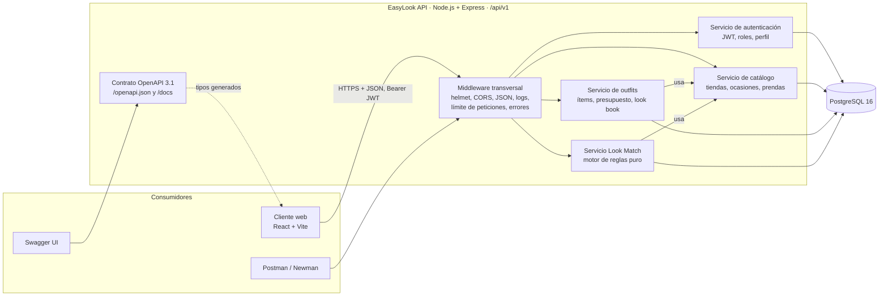

La solución tiene tres piezas que se despliegan por separado: el cliente web, la API y la base de datos. El cliente web no comparte código con la API; conoce el servicio únicamente a través del contrato OpenAPI publicado en `/openapi.json`, del cual se generan sus tipos. Postman y Swagger UI son otros dos consumidores del mismo contrato.

Dentro de la API, la decisión fue un monolito modular: un solo proceso y una sola base de datos, con cuatro módulos de servicio separados por carpeta (`auth`, `catalog`, `outfits`, `look-match`) que se comunican mediante funciones exportadas y no comparten estado. Para un MVP académico con un equipo de dos personas, esta forma es más fácil de desarrollar, probar y desplegar que un conjunto de microservicios, y conserva los límites que permitirían separarlos después (sección 2.4).

### 2.2 Capas internas de cada módulo

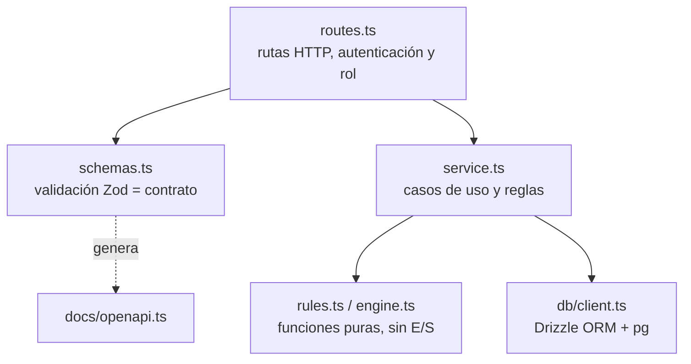

Cada petición sigue el mismo camino. La ruta aplica la autenticación y el rol que correspondan, valida el cuerpo, los parámetros y la consulta con el esquema Zod del módulo y llama al servicio. El servicio ejecuta el caso de uso dentro de una transacción cuando modifica varias filas, y delega las reglas de negocio a funciones puras (`outfit.rules.ts`, `look-match.engine.ts`) que no tocan la base de datos, lo que permite probarlas de forma aislada. Cualquier error, sea de validación, de negocio o inesperado, llega a un único manejador que lo convierte al formato uniforme de la sección 4.4.

### 2.3 Flujo de una petición: agregar una prenda a un outfit

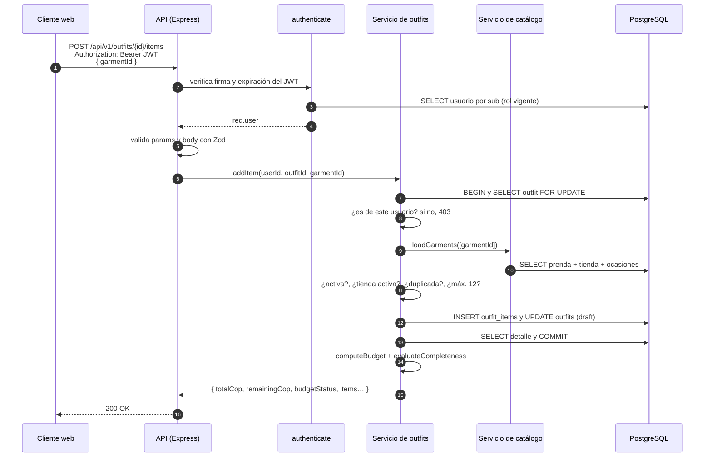

El bloqueo `SELECT … FOR UPDATE` sobre la fila del outfit serializa las peticiones concurrentes al mismo outfit. Una prueba de integración envía cinco veces la misma prenda en paralelo y comprueba que exactamente una responde 200 y cuatro responden 409.

### 2.4 Principios de Arquitectura Orientada a Servicios aplicados

| Principio SOA | Cómo se aplica en EasyLook | Dónde verlo |
| --- | --- | --- |
| Contrato de servicio estandarizado | Toda la interfaz está descrita en un documento OpenAPI 3.1 que se genera a partir de los mismos esquemas Zod que validan las peticiones, así que el contrato no puede quedar desincronizado del código. Los errores también son parte del contrato: siempre `{ error: { code, message, details } }` con códigos estables. | `src/docs/openapi.ts`, `/openapi.json`, `docs/openapi.json` |
| Bajo acoplamiento | El cliente web no importa nada de la API: sus tipos se generan del contrato publicado (`npm run api:types` en `web/`). Dentro de la API, Look Match y outfits dependen de funciones del catálogo, no de sus tablas internas ni de su estado. | `web/src/api/schema.d.ts`, `web/src/api/client.ts` |
| Abstracción | Los consumidores ven recursos (prendas, outfits, propuestas) y no la estructura de la base de datos. Por ejemplo, la tabla intermedia `garment_occasions` nunca aparece en la API; una prenda expone `occasions: ["office", "date"]`. | Esquemas de respuesta en `*.schemas.ts` |
| Reutilización | El mismo servicio de catálogo atiende a la tienda, al probador, a Look Match y al panel de administración. Las reglas de presupuesto y completitud se escribieron una vez y las usan tanto el servicio de outfits como el motor de Look Match. | `computeBudget`, `evaluateCompleteness`, `loadGarments` |
| Autonomía | Cada módulo es dueño de su lógica y de sus tablas, valida sus propias entradas y decide sus propios errores. El motor de Look Match es una función pura que recibe datos y devuelve un resultado, sin depender de la base de datos ni de la red. | `src/modules/*`, `look-match.engine.ts` |
| Sin estado | El servidor no guarda sesiones. Cada petición trae su JWT y la API la atiende sin recordar peticiones anteriores, lo que permite correr varias instancias detrás de un balanceador. | `src/middleware/auth.ts` |
| Descubrimiento | El servicio publica su descripción en `/openapi.json` y una interfaz navegable en `/docs`. Postman importa ese documento directamente. | `/docs` |
| Composición | Look Match compone el catálogo (prendas candidatas), las reglas de outfits (completitud y presupuesto) y su propio motor de puntuación. `apply-recommendation` compone a su vez Look Match con el servicio de outfits. | `look-match.service.ts`, `outfit.service.ts` |

### 2.5 Tecnologías y justificación

| Capa | Tecnología (versión) | Por qué se eligió |
| --- | --- | --- |
| Lenguaje | TypeScript 6 sobre Node.js 22 | El README sugería Node.js con Express y TypeScript. El tipado estático detecta en compilación errores de contrato entre módulos y entre la API y el cliente. |
| Framework HTTP | Express 5.3 | Es el framework REST más conocido de Node, tiene poca magia y la versión 5 propaga automáticamente los errores de funciones `async`, lo que elimina envoltorios en cada ruta. |
| Validación y contrato | Zod 4.6 + `@asteasolutions/zod-to-openapi` 9.1 | Un mismo esquema valida la entrada en tiempo de ejecución, da el tipo en TypeScript y genera el OpenAPI. Es la base del principio de contrato estandarizado. |
| Base de datos | PostgreSQL 16 | Relacional, con llaves foráneas, restricciones `CHECK`, arreglos (`text[]`) para tallas y estilos, y bloqueos de fila para la concurrencia. |
| ORM y migraciones | Drizzle ORM 0.45 + drizzle-kit 0.31 | El README sugería Prisma. Prisma necesita descargar motores binarios desde `binaries.prisma.sh`, y en el entorno de desarrollo esa descarga estaba bloqueada, lo que impedía probar. Drizzle cumple el mismo papel con TypeScript puro: esquema tipado, consultas parametrizadas y migraciones SQL versionadas en `drizzle/`. |
| Autenticación | jsonwebtoken 9 (HS256) + bcryptjs 3 | JWT permite un servicio sin estado (sección 5). bcrypt es el estándar para guardar contraseñas; la versión en JavaScript puro evita compilar dependencias nativas en Windows. |
| Seguridad HTTP | helmet 8, cors, express-rate-limit 8 | Cabeceras de seguridad, control de orígenes y límites de peticiones con configuración mínima. |
| Registro | pino 10 + pino-http | Registro estructurado en JSON con redacción de contraseñas y tokens. |
| Documentación | swagger-ui-express 5 | Interfaz interactiva sobre el mismo OpenAPI, con botón *Authorize* para JWT. |
| Pruebas | Jest 30 + ts-jest + Supertest 7; Newman 6 | Jest y Supertest son los sugeridos en el README. Newman ejecuta la colección de Postman desde la terminal. |
| Cliente web | React 19, Vite 8, React Router 8, TanStack Query 5, openapi-fetch 0.17 | React y Vite son el estándar actual para SPA. TanStack Query maneja caché y sincronización con el servidor. `openapi-fetch` con tipos generados por `openapi-typescript` hace que cada llamada esté tipada contra el contrato. |
| Contenedores e integración continua | Docker Compose, GitHub Actions | Compose levanta PostgreSQL con una línea. El flujo de CI corre lint, typecheck, pruebas y build en cada push. |

### 2.6 Despliegue

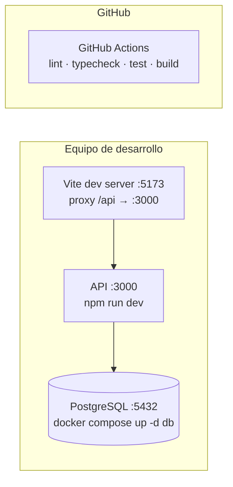

En desarrollo, Vite sirve el cliente en el puerto 5173 y redirige `/api`, `/docs` y `/openapi.json` hacia la API, de modo que el navegador habla con un solo origen. Para un despliegue real, el cliente se compila con `npm run build` dentro de `web/` y se publica como sitio estático con `VITE_API_URL` apuntando a la API, la API corre con `NODE_ENV=production` (que exige un `JWT_SECRET` propio y bloquea el script de datos semilla) y su `Dockerfile` aplica las migraciones al arrancar.

---

## 3. Modelo y diccionario de datos

### 3.1 Diagrama entidad-relación

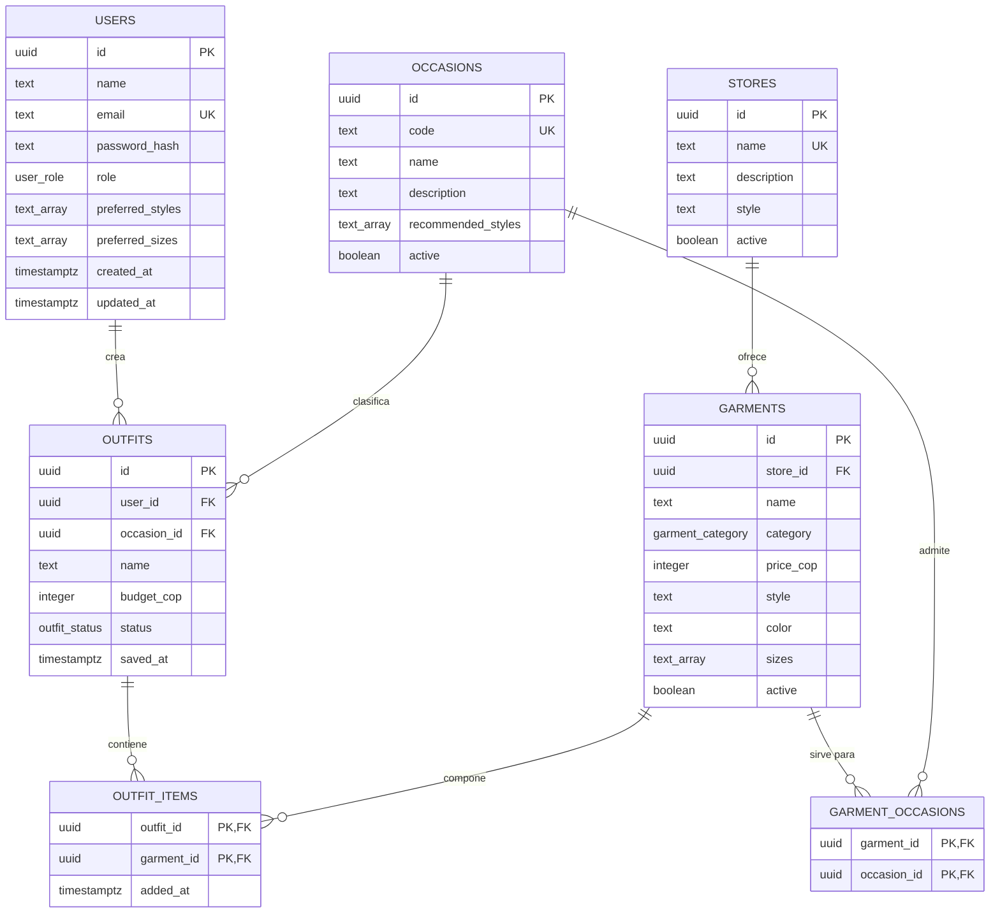

Frente al diagrama propuesto en el README se agregaron dos cosas. La tabla `garment_occasions` resuelve la relación muchos a muchos entre prendas y ocasiones, que el README necesitaba para filtrar por ocasión pero no modelaba. Y aparecieron columnas que las reglas exigían: `active` en tiendas, prendas y ocasiones para el borrado lógico, `sizes` y `color` para los filtros, `recommended_styles` en ocasiones para que Look Match sepa qué estilos favorecer, y las preferencias del usuario.

### 3.2 Base de datos

PostgreSQL 16. Todas las llaves primarias son UUID generados por la base con `gen_random_uuid()`, salvo en los datos semilla, que usan UUID versión 5 calculados a partir del nombre para que no cambien entre reinicios. Las fechas se guardan como `timestamptz` y la API las expone en ISO 8601 UTC. Los precios y presupuestos son `integer` en pesos colombianos. El esquema vive en `src/db/schema.ts` y las migraciones SQL generadas por drizzle-kit en `drizzle/`; `npm run db:migrate` las aplica y lleva el registro en la tabla `__drizzle_migrations`.

### 3.3 Tipos enumerados

| Tipo | Valores | Uso |
| --- | --- | --- |
| `user_role` | `user`, `admin` | Rol de la cuenta. El registro siempre crea `user`. |
| `garment_category` | `top`, `bottom`, `dress`, `shoes`, `outerwear`, `accessory` | Categoría de la prenda; define la completitud del outfit. |
| `outfit_status` | `draft`, `saved` | `saved` significa que el outfit pasó la validación y está en el look book. |

### 3.4 Diccionario de datos

**users**: cuentas de las personas que usan EasyLook.

| Columna | Tipo | Nulo | Por defecto | Restricciones | Descripción |
| --- | --- | --- | --- | --- | --- |
| id | uuid | No | `gen_random_uuid()` | PK | Identificador de la cuenta. |
| name | text | No | | | Nombre visible, de 2 a 80 caracteres. |
| email | text | No | | UNIQUE | Correo en minúsculas; es el usuario de inicio de sesión. |
| password_hash | text | No | | | Hash bcrypt (costo 12). Nunca sale de la API. |
| role | user_role | No | `'user'` | | Rol de autorización. |
| preferred_styles | text[] | No | `'{}'` | | Estilos que Look Match usa si la solicitud no los trae. |
| preferred_sizes | text[] | No | `'{}'` | | Tallas que Look Match usa si la solicitud no las trae. |
| created_at | timestamptz | No | `now()` | | Fecha de creación. |
| updated_at | timestamptz | No | `now()` | | Última modificación; la actualiza la aplicación. |

**stores**: tiendas ficticias del catálogo.

| Columna | Tipo | Nulo | Por defecto | Restricciones | Descripción |
| --- | --- | --- | --- | --- | --- |
| id | uuid | No | `gen_random_uuid()` | PK | Identificador de la tienda. |
| name | text | No | | UNIQUE | Nombre comercial ficticio. |
| description | text | No | `''` | | Descripción corta. |
| style | text | No | | Índice `stores_style_idx` | Estilo principal (`elegant`, `boho`…), filtrable. |
| active | boolean | No | `true` | | Si es `false`, la tienda y sus prendas desaparecen para el público y para Look Match. |
| created_at, updated_at | timestamptz | No | `now()` | | Auditoría. |

**occasions**: ocasiones para las que se arma un outfit.

| Columna | Tipo | Nulo | Por defecto | Restricciones | Descripción |
| --- | --- | --- | --- | --- | --- |
| id | uuid | No | `gen_random_uuid()` | PK | Identificador. |
| code | text | No | | UNIQUE | Código estable usado en la API (`date`, `office`…). |
| name | text | No | | | Nombre en español (`Cita`, `Oficina`…). |
| description | text | No | `''` | | Descripción para la interfaz. |
| recommended_styles | text[] | No | `'{}'` | | Estilos que mejor funcionan; pesan en el 40 % de ocasión de Look Match. |
| active | boolean | No | `true` | | Una ocasión inactiva no admite outfits ni propuestas nuevas. |
| created_at, updated_at | timestamptz | No | `now()` | | Auditoría. |

**garments**: prendas del catálogo.

| Columna | Tipo | Nulo | Por defecto | Restricciones | Descripción |
| --- | --- | --- | --- | --- | --- |
| id | uuid | No | `gen_random_uuid()` | PK | Identificador de la prenda. |
| store_id | uuid | No | | FK → stores.id `ON DELETE RESTRICT`; índice | Tienda que la ofrece. |
| name | text | No | | | Nombre. |
| description | text | No | `''` | | Descripción; entra en la búsqueda por texto. |
| category | garment_category | No | | Índice | Categoría. |
| price_cop | integer | No | | `CHECK (price_cop > 0)`; índice | Precio en pesos enteros. |
| style | text | No | | Índice | Estilo de la prenda. |
| color | text | No | | | Color en minúsculas con guiones (`azul-marino`). |
| sizes | text[] | No | `'{}'` | | Tallas disponibles; vacío significa talla única. |
| active | boolean | No | `true` | | Borrado lógico. |
| created_at, updated_at | timestamptz | No | `now()` | | Auditoría. |

**garment_occasions**: relación muchos a muchos entre prendas y ocasiones.

| Columna | Tipo | Nulo | Restricciones | Descripción |
| --- | --- | --- | --- | --- |
| garment_id | uuid | No | PK compuesta; FK → garments.id `ON DELETE CASCADE` | Prenda. |
| occasion_id | uuid | No | PK compuesta; FK → occasions.id `ON DELETE CASCADE`; índice | Ocasión para la que sirve. |

**outfits**: outfits de cada usuario; los guardados forman su look book.

| Columna | Tipo | Nulo | Por defecto | Restricciones | Descripción |
| --- | --- | --- | --- | --- | --- |
| id | uuid | No | `gen_random_uuid()` | PK | Identificador. |
| user_id | uuid | No | | FK → users.id `ON DELETE CASCADE`; índice | Propietario. |
| occasion_id | uuid | No | | FK → occasions.id `ON DELETE RESTRICT` | Ocasión. |
| name | text | No | | | Nombre del outfit. |
| budget_cop | integer | Sí | | `CHECK (budget_cop IS NULL OR budget_cop >= 0)` | Presupuesto; nulo significa sin presupuesto (`not_set`). |
| status | outfit_status | No | `'draft'` | | Borrador o guardado. |
| saved_at | timestamptz | Sí | | | Momento en que se guardó en el look book. |
| created_at, updated_at | timestamptz | No | `now()` | | Auditoría; el look book se ordena por `updated_at`. |

**outfit_items**: prendas de cada outfit.

| Columna | Tipo | Nulo | Por defecto | Restricciones | Descripción |
| --- | --- | --- | --- | --- | --- |
| outfit_id | uuid | No | | PK compuesta; FK → outfits.id `ON DELETE CASCADE` | Outfit. |
| garment_id | uuid | No | | PK compuesta; FK → garments.id `ON DELETE RESTRICT` | Prenda. La PK compuesta impide duplicados (regla 2). |
| added_at | timestamptz | No | `now()` | | Orden en que se agregaron las prendas. |

Los campos calculados `totalCop`, `remainingCop`, `budgetStatus`, `isComplete`, `missingCategories` y `storeCount` no se almacenan: la API los calcula en cada respuesta para que nunca queden desactualizados cuando cambia un precio.

### 3.5 Integridad referencial

Las reglas de borrado siguen el ciclo de vida de cada entidad. Si se elimina un usuario se eliminan sus outfits (`CASCADE`), y si se elimina un outfit se eliminan sus ítems. Una prenda que está en algún outfit no se puede borrar físicamente (`RESTRICT`), y por eso `DELETE /garments/{id}` la desactiva en lugar de borrarla; el outfit guardado la conserva y la interfaz la marca como no disponible. Una tienda con prendas y una ocasión con outfits tampoco se pueden borrar, solo desactivar.

### 3.6 Datos semilla

`npm run db:seed` carga 7 tiendas ficticias (Atelier Norte, Pliegue Studio, Calle Ocre, Lino & Sal, Noche Prisma, Vereda Clásica y Algodón de Barrio), las 5 ocasiones iniciales, 54 prendas (una de ellas desactivada para mostrar el borrado lógico) y dos cuentas: `admin@easylook.dev` con rol administrador y `demo@easylook.dev` con rol usuario. La prenda *Blazer crema* conserva el id del ejemplo del README.

---

## 4. Documentación y contratos de las APIs

### 4.1 Dónde está el contrato

| Recurso | Ubicación |
| --- | --- |
| Especificación OpenAPI 3.1 en vivo | `GET /openapi.json` |
| Documentación interactiva | `GET /docs` (Swagger UI, con *Authorize* para el JWT) |
| Copia versionada en el repositorio | `docs/openapi.json` (se regenera con `npm run docs:export`) |
| Colección de Postman y entorno | `postman/` |
| Tipos generados para el cliente | `web/src/api/schema.d.ts` (`npm run api:types` dentro de `web/`) |

### 4.2 Convenciones

| Elemento | Decisión |
| --- | --- |
| URL base | `/api/v1` |
| Formato | JSON UTF-8; cuerpo máximo de 100 KB |
| Autenticación | `Authorization: Bearer <JWT>` |
| Identificadores | UUID; un id mal formado en la ruta responde `400 VALIDATION_ERROR` |
| Fechas | ISO 8601 en UTC |
| Moneda | Pesos colombianos enteros en campos `…Cop`; `currency` siempre `"COP"` |
| Paginación | `page` (desde 1) y `limit` (por defecto 20, máximo 100); respuesta `{ data, meta: { page, limit, total, totalPages } }` |
| Nombres | Recursos en plural y en inglés; campos en camelCase |
| Errores | Objeto uniforme `{ error: { code, message, details? } }` |

### 4.3 Versionamiento

La versión mayor va en la URL (`/api/v1`) y la versión completa del contrato en `info.version` del OpenAPI (`1.0.0`). Se eligió versionar en la ruta porque es visible en cada petición, se puede probar desde el navegador sin cabeceras especiales y permite que dos versiones convivan en el mismo servidor montando otro enrutador.

La política es la siguiente. Los cambios compatibles hacia atrás (un campo nuevo en una respuesta, un parámetro opcional, un endpoint nuevo) se publican dentro de `v1` y suben la versión menor del contrato. Un cambio incompatible (quitar o renombrar un campo, cambiar un tipo, volver obligatorio un parámetro) obliga a publicar `/api/v2` en paralelo, mantener `v1` durante un periodo de transición anunciado con las cabeceras `Deprecation` y `Sunset`, y retirarla cuando los consumidores hayan migrado. Como el cliente web genera sus tipos a partir del contrato, un cambio incompatible aparece como error de compilación en el cliente antes de llegar a producción; esto pasó durante el desarrollo y se describe en la sección 7.5.

### 4.4 Formato de error y catálogo de códigos

```json
{
  "error": {
    "code": "BUDGET_EXCEEDED",
    "message": "El outfit supera el presupuesto definido.",
    "details": { "budgetCop": 300000, "totalCop": 419600 }
  }
}
```

| HTTP | Código | Cuándo ocurre |
| --- | --- | --- |
| 400 | `VALIDATION_ERROR` | Datos con formato inválido; `details.issues` lista cada campo y su problema. |
| 400 | `INVALID_JSON` | El cuerpo no es JSON válido. |
| 400 | `OUTFIT_INCOMPLETE` | Se intenta guardar un outfit sin top + bottom + zapatos ni vestido + zapatos; `details.missingCategories`. |
| 400 | `BUDGET_EXCEEDED` | Se intenta guardar un outfit sobre el presupuesto sin `allowOverBudget`. |
| 400 | `GARMENT_INACTIVE` | La prenda fue desactivada. |
| 400 | `STORE_INACTIVE` | La tienda de la prenda está desactivada. |
| 400 | `OCCASION_INACTIVE` | La ocasión está desactivada. |
| 401 | `UNAUTHORIZED` | Falta el token, está mal formado, alterado o vencido. |
| 401 | `INVALID_CREDENTIALS` | Correo o contraseña incorrectos (mismo mensaje para ambos). |
| 403 | `FORBIDDEN` | El rol no permite la acción (por ejemplo, un usuario creando prendas). |
| 403 | `FORBIDDEN_RESOURCE` | El outfit pertenece a otra persona. |
| 404 | `NOT_FOUND` | Recurso o ruta inexistente, o recurso desactivado para visitantes. |
| 404 | `GARMENT_NOT_IN_OUTFIT` | Se intenta retirar una prenda que no está en el outfit. |
| 409 | `GARMENT_ALREADY_ADDED` | La prenda ya está en el outfit. |
| 409 | `EMAIL_ALREADY_REGISTERED` | Ya existe una cuenta con ese correo. |
| 409 | `CONFLICT` | Nombre de tienda o código de ocasión repetido. |
| 413 | `VALIDATION_ERROR` | Cuerpo de más de 100 KB. |
| 422 | `NO_MATCH_FOUND` | Look Match no puede formar un look; `details.reason` es `BUDGET_TOO_LOW` (con `cheapestTotalCop`) o `MISSING_CATEGORIES`. |
| 429 | `RATE_LIMITED` | Se superó el límite de peticiones. |
| 500 | `INTERNAL_ERROR` | Error no controlado; el detalle queda en el log, nunca en la respuesta. |

### 4.5 Endpoints

**Autenticación**

| Método | Ruta | Acceso | Descripción | Éxito |
| --- | --- | --- | --- | --- |
| POST | `/auth/register` | Público | Crea una cuenta con rol `user` y devuelve un JWT | 201 |
| POST | `/auth/login` | Público | Inicia sesión y devuelve un JWT | 200 |
| GET | `/auth/me` | Autenticado | Usuario actual | 200 |
| PATCH | `/auth/me` | Autenticado | Cambia nombre y preferencias de estilo y talla | 200 |

**Tiendas y ocasiones**

| Método | Ruta | Acceso | Descripción | Éxito |
| --- | --- | --- | --- | --- |
| GET | `/stores` | Público | Lista tiendas; filtros `style`, `q`, `page`, `limit`; `includeInactive` solo administradores | 200 |
| GET | `/stores/{storeId}` | Público | Detalle con `garmentCount` | 200 |
| POST | `/stores` | Administrador | Crea una tienda | 201 |
| PATCH | `/stores/{storeId}` | Administrador | Edita o desactiva | 200 |
| GET | `/occasions` | Público | Lista ocasiones | 200 |
| POST | `/occasions` | Administrador | Crea una ocasión | 201 |
| PATCH | `/occasions/{occasionId}` | Administrador | Edita o desactiva | 200 |

**Prendas**

| Método | Ruta | Acceso | Descripción | Éxito |
| --- | --- | --- | --- | --- |
| GET | `/garments` | Público | Lista con filtros `q`, `storeId`, `category`, `style`, `occasion`, `color`, `size`, `minPriceCop`, `maxPriceCop`, `sort=price_asc\|price_desc\|name\|newest`, `page`, `limit` | 200 |
| GET | `/garments/{garmentId}` | Público | Detalle con tienda y ocasiones | 200 |
| POST | `/garments` | Administrador | Crea una prenda y sus ocasiones | 201 |
| PATCH | `/garments/{garmentId}` | Administrador | Edita (incluye reactivar con `active: true`) | 200 |
| DELETE | `/garments/{garmentId}` | Administrador | Desactiva (borrado lógico) | 204 |

**Outfits y look book**

| Método | Ruta | Acceso | Descripción | Éxito |
| --- | --- | --- | --- | --- |
| POST | `/outfits` | Autenticado | Crea un outfit vacío | 201 |
| GET | `/outfits` | Autenticado | Lista los outfits propios; `status=saved` es el look book; filtro `occasion` | 200 |
| GET | `/outfits/{outfitId}` | Propietario | Detalle con prendas, presupuesto y completitud | 200 |
| PATCH | `/outfits/{outfitId}` | Propietario | Cambia nombre, ocasión o presupuesto (`null` lo quita) | 200 |
| DELETE | `/outfits/{outfitId}` | Propietario | Elimina el outfit | 204 |
| POST | `/outfits/{outfitId}/items` | Propietario | Agrega una prenda y recalcula | 200 |
| DELETE | `/outfits/{outfitId}/items/{garmentId}` | Propietario | Retira una prenda y recalcula | 200 |
| POST | `/outfits/{outfitId}/finalize` | Propietario | Valida y guarda en el look book; acepta `{ "allowOverBudget": true }` | 200 |
| POST | `/outfits/{outfitId}/apply-recommendation` | Propietario | Copia una propuesta; `{ garmentIds, mode: "replace" \| "append" }` | 200 |

**Look Match y servicio**

| Método | Ruta | Acceso | Descripción | Éxito |
| --- | --- | --- | --- | --- |
| POST | `/recommendations/look-match` | Público o autenticado | Hasta tres propuestas explicables | 200 |
| GET | `/health` (fuera de `/api/v1`) | Público | Estado del servicio | 200 |
| GET | `/openapi.json` (fuera de `/api/v1`) | Público | Contrato | 200 |

### 4.6 Ejemplos del contrato

Crear un outfit, `POST /api/v1/outfits`:

```json
{ "name": "Brunch de domingo", "occasionCode": "brunch", "budgetCop": 350000, "currency": "COP" }
```

Respuesta `201 Created` (resumida):

```json
{
  "id": "f37de540-75ee-4b33-a072-20fff36c8c55",
  "name": "Brunch de domingo",
  "occasion": { "code": "brunch", "name": "Brunch" },
  "budgetCop": 350000,
  "currency": "COP",
  "totalCop": 0,
  "remainingCop": 350000,
  "budgetStatus": "within_budget",
  "isComplete": false,
  "missingCategories": ["top", "bottom", "shoes"],
  "storeCount": 0,
  "status": "draft",
  "itemCount": 0,
  "items": [],
  "createdAt": "2026-11-27T01:37:12.401Z",
  "updatedAt": "2026-11-27T01:37:12.401Z",
  "savedAt": null
}
```

Agregar una prenda, `POST /api/v1/outfits/{outfitId}/items` con `{ "garmentId": "28a58b2a-c847-44d4-a2ca-ec1dc35b1001" }`, responde `200 OK` con `totalCop: 149900`, `remainingCop: 200100` y la prenda con su tienda, igual que el ejemplo del README.

Pedir propuestas, `POST /api/v1/recommendations/look-match`:

```json
{
  "occasionCode": "date",
  "budgetCop": 400000,
  "preferredStyles": ["elegant", "minimal"],
  "excludedCategories": ["outerwear"],
  "allowOverBudget": false
}
```

Respuesta `200 OK` (una propuesta, resumida):

```json
{
  "occasion": "date",
  "budgetCop": 400000,
  "currency": "COP",
  "appliedPreferences": { "preferredStyles": ["elegant", "minimal"], "sizes": [], "source": "request" },
  "evaluatedCombinations": 150,
  "withinBudgetFound": true,
  "notice": null,
  "recommendations": [
    {
      "label": "balanced",
      "score": 100,
      "scoreBreakdown": { "occasion": 1, "style": 1, "budget": 1, "storeVariety": 1 },
      "totalCop": 399800,
      "remainingCop": 200,
      "budgetStatus": "within_budget",
      "storeCount": 2,
      "garmentIds": ["d9053b76-e189-5b7a-9220-35dbd509eab2", "98b77595-5536-549a-8605-22fad89a03f7"],
      "items": [
        { "name": "Vestido negro midi", "category": "dress", "priceCop": 249900, "store": { "name": "Atelier Norte" } },
        { "name": "Zapatos de tacón bajo", "category": "shoes", "priceCop": 149900, "store": { "name": "Pliegue Studio" } }
      ],
      "explanation": [
        "Incluye las piezas mínimas para un look completo: vestido y zapatos.",
        "Todas las prendas siguen los estilos recomendados para la ocasión \"Cita\".",
        "Coincide por completo con tus estilos preferidos (elegant, minimal).",
        "Se mantiene dentro del presupuesto y te quedan $200 COP.",
        "Combina prendas de 2 tiendas.",
        "Tiene el mejor puntaje general entre 150 combinaciones evaluadas."
      ]
    }
  ]
}
```

Frente al ejemplo del README, las propuestas devuelven cada prenda como objeto en lugar de solo su nombre, y agregan `garmentIds`, que es exactamente lo que recibe `apply-recommendation`.

---

## 5. Autenticación y seguridad

### 5.1 Flujo de autenticación con JWT

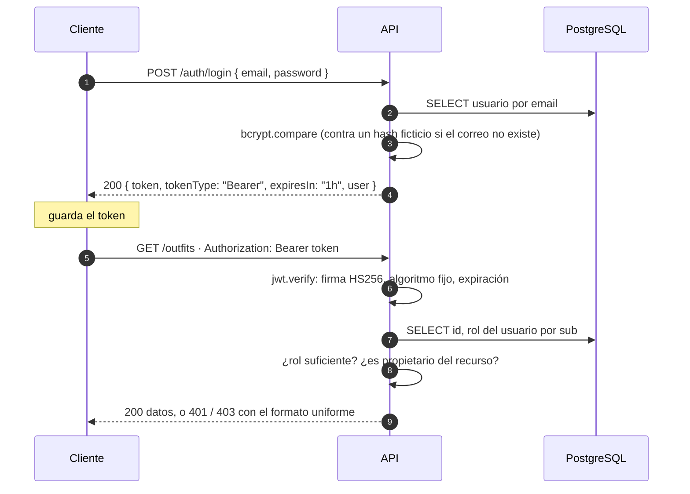

Un token emitido por la API tiene esta forma una vez decodificado:

```json
{ "alg": "HS256", "typ": "JWT" }
{ "sub": "b1b5e9d5-5d43-57c1-8940-23f1dc14b270", "role": "user", "iat": 1795744262, "exp": 1795747862 }
```

`sub` es el id del usuario y `exp` llega una hora después de `iat` (configurable con `JWT_EXPIRES_IN`). Aunque el token trae el rol, la API no confía en él: en cada petición lee el rol vigente desde la base de datos, de modo que una cuenta eliminada o a la que se le cambia el rol pierde el acceso sin esperar a que el token venza. La verificación fija el algoritmo en HS256, lo que impide aceptar tokens sin firma (`alg: none`) o firmados con otro algoritmo.

### 5.2 Autorización

Hay dos niveles. El primero es por rol: las rutas de mantenimiento del catálogo exigen `admin` mediante `requireRole('admin')` y responden `403 FORBIDDEN` a cualquier otro usuario. El segundo es por propiedad: cada operación sobre un outfit comprueba que `outfit.user_id` sea el usuario del token y, si no lo es, responde `403 FORBIDDEN_RESOURCE`. Esta regla aplica también a los administradores, que mantienen el catálogo pero no ven outfits ajenos. Los listados solo devuelven los outfits del propio usuario.

### 5.3 Controles de seguridad

| Riesgo | Control | Dónde |
| --- | --- | --- |
| Robo de contraseñas | bcrypt con costo 12; las contraseñas se limitan a 72 bytes porque bcrypt ignora lo que sigue | `auth.service.ts`, `auth.schemas.ts` |
| Enumeración de cuentas | El login responde el mismo error para correo inexistente y contraseña incorrecta, y compara contra un hash ficticio para que ambos casos tarden lo mismo | `auth.service.ts` |
| Escalada de privilegios | El registro ignora cualquier campo `role` y siempre crea `user`; el rol se lee de la base en cada petición | `auth.service.ts`, `middleware/auth.ts` |
| Tokens falsificados | Firma HS256 con un secreto de al menos 32 caracteres; en producción la API no arranca con el secreto de ejemplo | `config/env.ts` |
| Fuerza bruta y abuso | Registro e inicio de sesión comparten 20 peticiones cada 15 minutos por IP; Look Match admite 30 por minuto. Las respuestas incluyen las cabeceras estándar `RateLimit` y `RateLimit-Policy` | `middleware/rate-limit.ts` |
| Inyección SQL | Todas las consultas son parametrizadas por Drizzle; la búsqueda por texto escapa los comodines `%` y `_` de `LIKE` | `garments.service.ts`, `stores.service.ts` |
| Datos inválidos | Validación Zod de cuerpo, parámetros y consulta en todas las rutas; enteros para dinero; UUID para ids | `*.schemas.ts` |
| Acceso a datos ajenos (IDOR) | Verificación de propiedad en cada operación sobre outfits | `outfit.service.ts` |
| Condiciones de carrera | Bloqueo `SELECT … FOR UPDATE` del outfit y llave primaria compuesta como segunda barrera | `outfit.service.ts` |
| Cabeceras inseguras | helmet (CSP, `X-Content-Type-Options`, `X-Frame-Options`, HSTS, etc.) y `x-powered-by` desactivado | `app.ts` |
| Orígenes no autorizados | CORS configurable con `CORS_ORIGIN` | `app.ts` |
| Cuerpos grandes | Límite de 100 KB por petición | `app.ts` |
| Fuga de información | Los errores 500 devuelven un mensaje genérico; el log redacta `authorization`, `password`, `passwordHash` y `token` | `error-handler.ts`, `logger.ts` |
| Secretos en el repositorio | `.env` está en `.gitignore`; solo se versiona `.env.example` | raíz |

### 5.4 Limitaciones conocidas

El cliente web guarda el JWT en `localStorage`, lo que lo deja expuesto si la interfaz llegara a tener una vulnerabilidad XSS. React escapa el contenido por defecto y la interfaz no inserta HTML sin escapar, pero una versión de producción debería mover el token a una cookie `HttpOnly` con `SameSite=Strict`. Tampoco hay tokens de renovación ni lista de revocación; la expiración corta de una hora y la lectura del usuario desde la base en cada petición acotan el riesgo. El límite de peticiones se guarda en la memoria del proceso, así que con varias instancias habría que llevarlo a un almacén compartido como Redis.

---

## 6. Implementación técnica

### 6.1 Estructura del repositorio

```
EasyLook/
  src/                       API
    config/env.ts            variables de entorno validadas con Zod
    db/                      esquema, cliente, migración y datos semilla
    lib/                     errores, paginación, esquemas y utilidades comunes
    middleware/              JWT y roles, límites de peticiones, manejo de errores
    modules/
      auth/                  registro, login y perfil
      catalog/               tiendas, ocasiones y prendas
      outfits/               outfits, ítems, reglas de presupuesto y completitud
      look-match/            motor de reglas, configuración, filtro de tallas y ruta
    docs/openapi.ts          generación del contrato OpenAPI
    app.ts, server.ts        composición de la aplicación y arranque
  drizzle/                   migraciones SQL
  tests/unit/                pruebas de reglas puras
  tests/integration/         pruebas HTTP contra PostgreSQL
  web/                       cliente React + Vite
    src/api/                 cliente generado del contrato y hooks de datos
    src/pages/               tienda, probador, outfits, Look Match, ingreso, catálogo
    src/components/          riel, medidor de presupuesto, siluetas de prendas
  postman/                   colección y entorno
  docs/                      manuales, OpenAPI exportado y evidencias
```

### 6.2 Configuración

| Variable | Por defecto | Descripción |
| --- | --- | --- |
| `NODE_ENV` | `development` | `production` exige un `JWT_SECRET` propio y bloquea el seed. |
| `PORT` | `3000` | Puerto de la API. |
| `DATABASE_URL` | (obligatoria) | Cadena de conexión a PostgreSQL. |
| `JWT_SECRET` | (obligatoria) | Secreto de firma, mínimo 32 caracteres. |
| `JWT_EXPIRES_IN` | `1h` | Vida del token. |
| `BCRYPT_ROUNDS` | `12` | Costo de bcrypt (las pruebas usan 4). |
| `CORS_ORIGIN` | `*` | Orígenes permitidos, separados por coma. |
| `RATE_LIMIT_ENABLED` | `true` | Activa los límites de peticiones. |
| `LOG_LEVEL` | `info` | Nivel de registro. |
| `SEED_*` | cuentas demo | Correos y contraseñas de las cuentas creadas por el seed. |
| `VITE_API_URL` (en `web/`) | vacío | URL de la API para el cliente compilado; vacío usa el proxy de Vite. |

La configuración se valida al arrancar; si falta una variable o es inválida, el proceso termina con un mensaje que dice cuál.

### 6.3 Módulo de outfits

Las reglas de negocio están en `outfit.rules.ts` como funciones puras. `computeBudget(budgetCop, prices)` devuelve el total, el saldo y el estado. `evaluateCompleteness(categories)` devuelve si el outfit está completo, su estructura (`top_bottom_shoes` o `dress_shoes`) y qué categorías faltan por el camino más corto; por ejemplo, con solo un top falta `bottom`, y con solo un vestido faltan `shoes`. El servicio usa estas funciones para construir cada respuesta y para validar en `finalize`.

Cambiar la ocasión, el presupuesto o las prendas de un outfit guardado lo devuelve a borrador, porque esos cambios pueden invalidar lo que se validó; cambiar solo el nombre no lo hace. Cada outfit admite hasta 12 prendas.

### 6.4 Motor Look Match

El motor está en `look-match.engine.ts`, es una función pura y determinista y sus parámetros están en `look-match.config.ts`.

1. **Candidatas.** El servicio trae las prendas activas, de tiendas activas y marcadas para la ocasión. Si hay tallas (de la solicitud o del perfil), se filtran por categoría: una talla que no existe en una categoría no la filtra, así que pedir `37` filtra zapatos sin vaciar la ropa. Las prendas sin talla siempre pasan.
2. **Lista corta.** Por cada categoría base se conservan las 12 prendas que mejor encajan con la ocasión y el estilo, más las 12 más baratas, para que la opción económica sea realmente la más barata.
3. **Combinaciones.** Se generan todas las combinaciones `top + bottom + zapatos` y `vestido + zapatos` y se descartan las que superan el presupuesto.
4. **Puntaje.** Cada combinación recibe un puntaje de 0 a 100:

   `puntaje = 100 × (0,4 × ocasión + 0,3 × estilo + 0,2 × presupuesto + 0,1 × variedad)`

   La ocasión es el promedio por prenda de 1 si su estilo está entre los recomendados para la ocasión y 0,5 si no. El estilo es la proporción de prendas en los estilos preferidos o, si no hay preferencias, la proporción del estilo más repetido, que premia la coherencia. El presupuesto vale entre 0,5 y 1 según qué tanto del presupuesto se usa, con el máximo desde el 90 %, y 1 si no hay presupuesto. La variedad es `(tiendas − 1) / (prendas − 1)`.
5. **Selección.** `balanced` es la combinación de mayor puntaje. `budget` es la más barata entre las que cuestan menos que `balanced` y quedan a 20 puntos o menos de ella. `statement` es la más costosa dentro de ese mismo margen y, si queda espacio en el presupuesto, suma un complemento (chaqueta o accesorio). Las tres se eligen para que compartan como máximo una prenda.
6. **Sin resultados.** Si faltan categorías responde `422` con `MISSING_CATEGORIES`. Si ninguna combinación cabe en el presupuesto responde `422` con `BUDGET_TOO_LOW` y el costo del look más barato, salvo que la solicitud traiga `allowOverBudget: true`, en cuyo caso devuelve solo esa opción marcada como `over_budget`.

Con el catálogo semilla, una solicitud evalúa entre 45 combinaciones (fiesta) y 160 (casual) en pocos milisegundos.

### 6.5 Cliente web

El cliente está en `web/` y es una aplicación de una sola página con seis vistas: la tienda (catálogo con filtros y barra del outfit activo), el probador (detalle del outfit), mis outfits (creación y look book), Look Match, ingreso y registro, y el catálogo de administración (CRUD de prendas). Las llamadas a la API pasan por `openapi-fetch` con los tipos generados del contrato y por TanStack Query, que guarda en caché las respuestas y las invalida cuando una mutación cambia un outfit. Los errores de la API se muestran con su mensaje y su código (`GARMENT_ALREADY_ADDED`, `BUDGET_EXCEEDED`…), lo que hace visible en la interfaz el contrato de errores.

El elemento visual central es el riel del probador: las prendas cuelgan de una barra dibujadas como siluetas en su color del catálogo, y los zapatos y accesorios quedan en una repisa debajo, al lado del medidor de presupuesto que se actualiza con cada cambio. La interfaz se adapta a móvil, tiene foco visible para teclado, respeta `prefers-reduced-motion` y usa elementos semánticos (`role="meter"`, `aria-pressed`, `aria-live`) para lectores de pantalla.

### 6.6 Ejecución

```bash
# API
npm install
cp .env.example .env            # cambiar JWT_SECRET
docker compose up -d db         # PostgreSQL 16 en :5432
npm run db:reset                # migraciones y datos semilla
npm run dev                     # http://localhost:3000 (docs en /docs)

# Cliente web, en otra terminal
cd web
npm install
npm run dev                     # http://localhost:5173
```

| Script | Qué hace |
| --- | --- |
| `npm run dev` / `build` / `start` | Desarrollo con recarga, compilación y ejecución compilada |
| `npm run db:generate` / `db:migrate` / `db:seed` / `db:reset` | Migraciones y datos semilla |
| `npm test`, `test:unit`, `test:integration` | Pruebas con Jest |
| `npm run test:postman` | Colección de Postman con Newman |
| `npm run lint`, `typecheck` | ESLint y TypeScript |
| `npm run docs:export` | Regenera `docs/openapi.json` |
| `web: npm run api:types` | Regenera los tipos del cliente desde el contrato |

---

## 7. Evidencias de las pruebas

### 7.1 Estrategia

Las pruebas se organizaron en cuatro niveles. Las unitarias cubren las reglas puras (presupuesto, completitud, motor de Look Match, filtro de tallas y UUID) sin base de datos. Las de integración levantan la aplicación Express con Supertest contra una base PostgreSQL real (`easylook_test`), que se reinicia con los datos semilla al comenzar cada archivo de pruebas que modifica datos. Las funcionales recorren la API desplegada con la colección de Postman, ejecutada con Newman. Por último, la interfaz web se probó manualmente en el navegador contra la API real, en escritorio y en móvil.

### 7.2 Pruebas unitarias y de integración (Jest)

Resultado de `npm test` (salida completa en [evidencias/jest-salida.txt](evidencias/jest-salida.txt)):

```
Test Suites: 8 passed, 8 total
Tests:       84 passed, 84 total
```

| Archivo | Pruebas | Qué cubre |
| --- | --- | --- |
| `unit/outfit.rules.test.ts` | 11 | Presupuesto (`not_set`, dentro, sobre, vacío) y completitud por ambos caminos |
| `unit/look-match.engine.test.ts` | 18 | Pesos 40/30/20/10, selección de las tres propuestas, exclusiones, presupuesto insuficiente, `allowOverBudget`, determinismo, lista corta y filtro de tallas |
| `unit/uuid.test.ts` | 2 | UUID v5 contra el vector de referencia de Python |
| `integration/auth.test.ts` | 8 | Registro, duplicado, validación, login, credenciales incorrectas, token ausente o alterado, preferencias |
| `integration/catalog.test.ts` | 14 | Paginación, filtros, límite de 100, conteo de prendas por tienda, roles 401/403, CRUD de tiendas, ocasiones y prendas, borrado lógico |
| `integration/outfits.test.ts` | 16 | CRUD, totales, duplicados, concurrencia, propiedad 403, completitud, presupuesto, look book, vuelta a borrador |
| `integration/look-match.test.ts` | 9 | Ejemplo del README, reproducibilidad, 422, `allowOverBudget`, preferencias del perfil, `apply-recommendation` |
| `integration/http.test.ts` | 6 | Salud, 404, JSON inválido, contrato OpenAPI, Swagger y cabeceras de seguridad |

Cobertura de código ([evidencias/jest-cobertura.txt](evidencias/jest-cobertura.txt)):

| Métrica | Cobertura |
| --- | --- |
| Sentencias | 92,62 % (1042 de 1125) |
| Ramas | 78,18 % (344 de 440) |
| Funciones | 90,07 % (227 de 252) |
| Líneas | 94,68 % (944 de 997) |

### 7.3 Pruebas funcionales con Postman

La colección `postman/EasyLook.postman_collection.json` tiene 64 peticiones con pruebas automáticas y se ejecutó con Newman contra la API con los datos semilla. Reporte navegable en [evidencias/newman-reporte.html](evidencias/newman-reporte.html) y salida de consola en [evidencias/newman-salida.txt](evidencias/newman-salida.txt).

```
requests       64 ejecutadas, 0 fallidas
test-scripts  128 ejecutados, 0 fallidos
assertions    224 ejecutadas, 0 fallidas
tiempo promedio de respuesta 24 ms
```

| Carpeta | Escenarios exitosos | Escenarios de error |
| --- | --- | --- |
| 0. Servicio | Salud, contrato OpenAPI 3.1 | Ruta inexistente (404), JSON malformado (400) |
| 1. Autenticación y JWT | Registro (201), login, login de administrador, perfil, preferencias | Correo duplicado (409), datos inválidos (400), contraseña incorrecta (401), sin token (401), token alterado (401) |
| 2. Tiendas y ocasiones | Listar con paginación, filtrar, detalle, ocasiones, crear y desactivar tienda | Límite mayor a 100 (400), crear como usuario (403), nombre repetido (409), tienda desactivada para visitantes (404) |
| 3. Prendas | Filtros combinados con orden verificado, búsqueda, detalle, crear, editar, desactivar (204) | Id inválido (400), inexistente (404), sin token (401), precio decimal (400), prenda desactivada (404) |
| 4. Outfits y look book | Crear, listar, agregar cuatro prendas de dos tiendas, editar presupuesto, guardar aceptando el exceso, look book, retirar, eliminar (204) | Ocasión inexistente (400), sin token (401), duplicada (409), prenda desactivada (400), incompleto (400), sobre presupuesto (400), prenda ausente (404), outfit ajeno (403), outfit eliminado (404) |
| 5. Look Match | Ejemplo del README, opción más cercana, crear outfit y aplicar la propuesta | Presupuesto insuficiente (422), exclusión imposible (422), ids repetidos (400) |

Además de las pruebas por petición, la colección verifica en todas que la respuesta llegue en menos de 2 segundos y que los errores vengan en JSON.

### 7.4 Pruebas de la interfaz web

La interfaz se probó en el navegador contra la API real con la cuenta demo y la de administrador. Se recorrió el flujo completo de la sección 19 del README: ingresar, crear el outfit "Brunch de domingo" con $350.000, agregar desde la tienda una blusa, una falda, unas baletas y un sombrero de dos tiendas viendo el saldo bajar a $20.400, comprobar el aviso `GARMENT_ALREADY_ADDED` al repetir una prenda, guardar en el look book, pedir propuestas a Look Match para una cita, convertir la propuesta balanceada en outfit con "Probar este look", y en el panel de administración crear la prenda "Camisa oxford" y desactivarla, verificando que la API pública dejara de devolverla.

| Vista | Evidencia |
| --- | --- |
| Tienda con el outfit activo y su presupuesto | 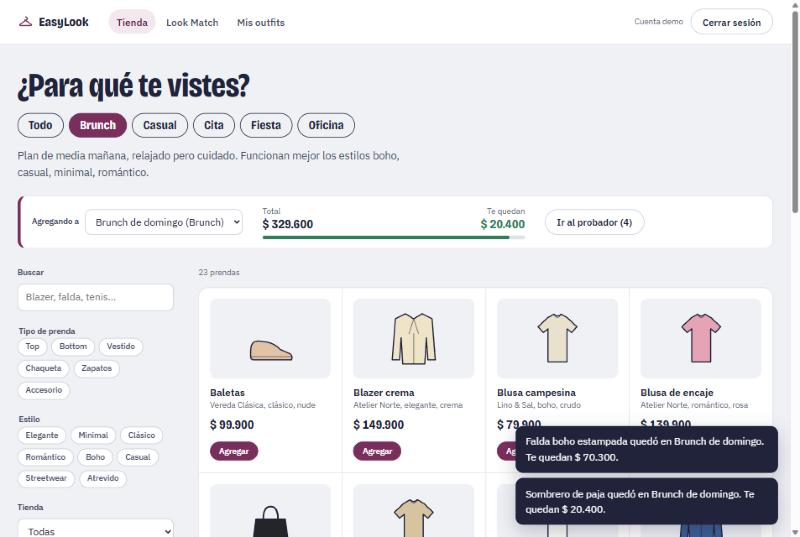 |
| Probador con el riel y el medidor | 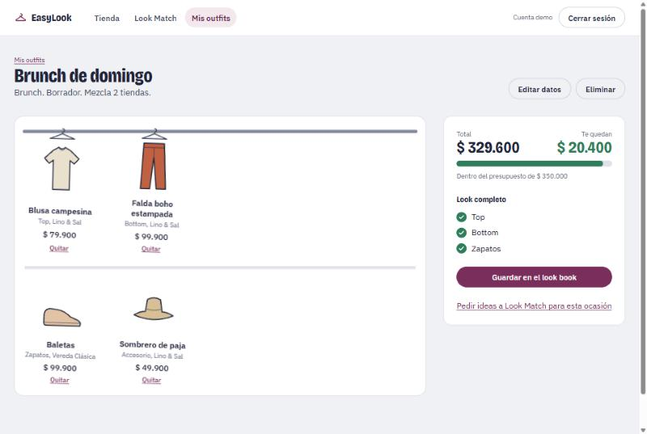 |
| Look Match con tres propuestas | 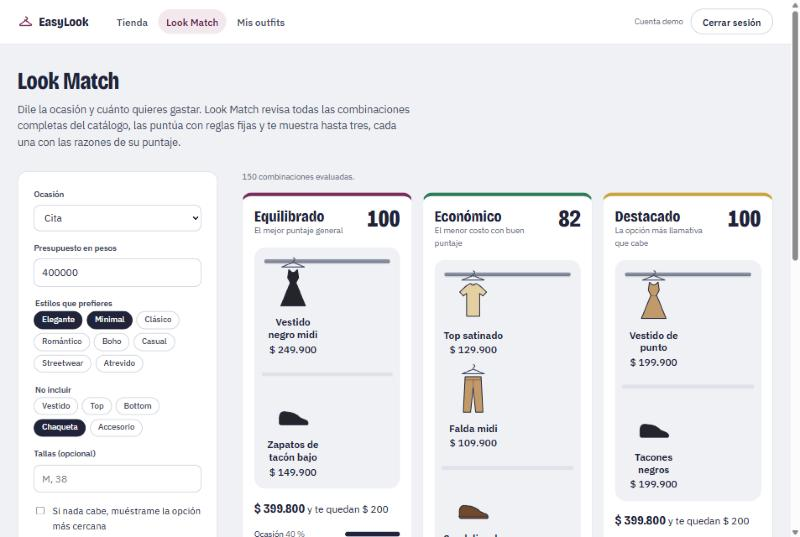 |
| Catálogo de administración | 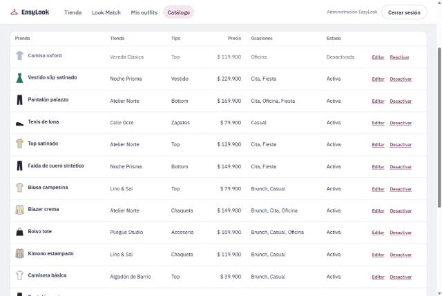 |
| Vista móvil | 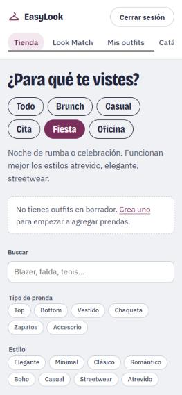 |

### 7.5 Defectos encontrados y corregidos

Las pruebas encontraron problemas reales durante el desarrollo, y vale la pena registrarlos porque muestran qué detectó cada nivel.

| Defecto | Cómo se detectó | Corrección |
| --- | --- | --- |
| `garmentCount` de las tiendas siempre era 0. Dentro de la subconsulta, Drizzle generó `"store_id" = "id"` sin calificar las tablas, y `"id"` se resolvía contra `garments`. | Revisando el log SQL de la API durante la corrida de Newman; las pruebas de integración solo comprobaban que el campo existiera. | Columnas calificadas a mano y una prueba nueva que compara el conteo con el total real de prendas de la tienda. |
| La opción `budget` de Look Match era la combinación más barata aunque puntuara 37 sobre 100, lo que no ayudaba a decidir. | Revisión manual de respuestas con el catálogo semilla. | Se eligió entre las combinaciones a 20 puntos o menos de la mejor, con una prueba unitaria. |
| Una diversidad mal ordenada podía escoger como `budget` una combinación más cara que `balanced` y descartarla. | Prueba unitaria `makes the budget option cheaper than the balanced one`. | Se filtran primero las combinaciones más baratas. |
| Guardar solo la talla de zapato (37) en el perfil dejaba sin ropa a Look Match, porque las tallas de ropa son letras. | Prueba de integración de preferencias del perfil (`422` inesperado). | Filtro de tallas por categoría (`look-match.sizes.ts`) con pruebas unitarias. |
| Un correo con espacios o mayúsculas se validaba antes de normalizarse y se rechazaba. | Prueba de integración de registro. | Validación del formato después de `trim()` y `toLowerCase()`. |
| El cliente generado marcaba como obligatorios los campos con valor por defecto del contrato (por ejemplo `description` al crear una prenda). | Error de compilación en `web/` al construir el formulario de prendas. | Generación de tipos con `--default-non-nullable false`; el contrato de la API estaba bien. |
| En Windows PowerShell 5, `Set-Content -Encoding utf8` escribe el `.env` con BOM, y la primera variable se leería con un carácter extra. | Al preparar la instalación en el equipo Windows de una integrante. | El `.env` se escribió sin BOM. |

---

## 8. Conclusiones técnicas

Generar el contrato OpenAPI desde los mismos esquemas que validan las peticiones resultó la decisión con más efecto en el resto del proyecto. La documentación de Swagger, la colección de Postman y los tipos del cliente web salen de una sola fuente, y cuando algo no coincidía el error apareció al compilar o al correr las pruebas, no durante la demostración. El caso de los campos con valor por defecto en el cliente generado es un ejemplo pequeño de eso: un desacuerdo entre la API y su consumidor que se vio en el editor antes de llegar a un usuario.

Separar las reglas de negocio en funciones puras, sin acceso a la base de datos, permitió probar Look Match con catálogos pequeños hechos a mano, comprobar los pesos 40/30/20/10 con números exactos y demostrar que el resultado es el mismo sin importar el orden de las prendas. Que el recomendador sea un conjunto de reglas y no un modelo de aprendizaje automático fue una ventaja para un proyecto académico, porque cada propuesta se puede explicar con su desglose y reproducir en vivo.

Las pruebas de integración contra una base real, en lugar de simulaciones, encontraron problemas que una base simulada habría escondido, como la carrera al agregar la misma prenda en paralelo, que solo se resuelve con el bloqueo de fila. Aun así, el defecto del conteo de prendas por tienda pasó las pruebas porque ninguna verificaba el valor, solo que el campo existiera. Lo encontró la lectura del log durante la corrida de Newman, y de ahí quedó como aprendizaje que una prueba que no compara contra un valor esperado da una cobertura que no protege.

### 8.1 Dificultades

La herramienta sugerida para el ORM, Prisma, no se pudo usar porque necesita descargar motores binarios desde un dominio que el entorno de desarrollo bloqueaba; se reemplazó por Drizzle sin cambiar el diseño de datos. Docker tampoco podía descargar imágenes en ese mismo entorno, así que el servicio de base de datos del `docker-compose.yml` se validó en el equipo de una de las integrantes, donde además había un PostgreSQL 13 instalado en otro puerto. La imagen de la API (`Dockerfile`) quedó escrita pero no se construyó en ninguno de los dos entornos. Ajustar el algoritmo de Look Match para que la opción económica fuera útil y no solo barata tomó más iteraciones que escribir el motor.

### 8.2 Oportunidades de mejora

| Mejora | Motivo |
| --- | --- |
| Guardar el JWT en una cookie `HttpOnly` y agregar tokens de renovación con revocación | Reducir el impacto de un XSS y permitir cerrar sesiones de forma remota |
| Llevar el límite de peticiones a Redis | Que funcione con varias instancias de la API |
| Imágenes reales de las prendas en un almacenamiento de objetos | El catálogo usa siluetas dibujadas por categoría y color |
| Separar Look Match en un servicio independiente | Escalarlo por separado si el catálogo crece; los límites del módulo ya lo permiten |
| Paginación por cursor en el catálogo | Rendimiento estable con catálogos grandes |
| Pruebas de extremo a extremo de la interfaz con Playwright | Hoy la interfaz se prueba manualmente |
| Observabilidad con OpenTelemetry | Trazas por petición y métricas de latencia en producción |
| Recomendaciones que aprendan de los looks guardados | Ajustar los pesos por usuario sin perder la explicación del puntaje |
